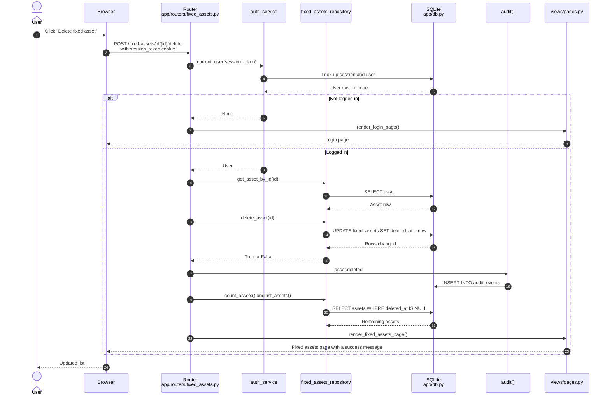

# AI Hackaton

A minimal FastAPI web project with SQLite-backed authentication.

## Architecture

The project now uses a modular monolith layering:

* `app/main.py` - app bootstrap and router registration
* `app/routers/auth.py` - auth, dashboard, and users HTTP routes
* `app/routers/analytics.py` - analytics page (`/analytics`)
* `app/services/dashboard_service.py` - what the dashboard and analytics page show
* `app/repositories/reporting_repository.py` - read-only figures for them
* `app/routers/fixed_assets.py` - fixed asset HTTP routes
* `app/routers/categories.py` - fixed asset category HTTP routes
* `app/routers/locations.py` - location HTTP routes (`/locations`)
* `app/routers/asset_import.py` - CSV import of fixed assets (`/fixed-assets/import`)
* `app/services/asset_import_service.py` - reading and checking import files
* `app/views/pages.py` - server-rendered HTML page helpers
* `app/views/templates/` - Jinja2 templates for auth, users, fixed assets, and category pages
* `app/static/app.css` - shared stylesheet (sidebar layout, design tokens, tables, forms), served at `/static/app.css`
* `app/services/auth_service.py` - auth/session business logic
* `app/services/fixed_assets_service.py` - fixed asset business rules (validation, filters, pagination normalization)
* `app/repositories/auth_repository.py` - auth/session data access abstraction
* `app/repositories/fixed_assets_repository.py` - fixed asset and category data access abstraction
* `app/repositories/locations_repository.py` - location data access abstraction
* `app/db.py` - SQLite schema management and lower-level DB operations
* `app/config.py` - environment-based settings (production mode, storage paths, admin account, email)
* `app/services/email_service.py` - sends password reset emails over SMTP
* `app/logging_config.py` - logging setup, request context and the `audit()` helper
* `app/repositories/audit_repository.py` - `audit_events` table: storing, filtering and retention
* `app/services/audit_view_service.py` - readable event names and details for the audit log UI
* `app/routers/audit.py` - audit log page (`/audit-log`)

Layering rule:

* Routes call services/repositories.
* Services contain business logic and input normalization.
* Repositories isolate persistence calls.

## How it works

Every page is rendered on the server. A request goes through the same layers each time: the router checks the session cookie, a service validates the input, a repository reads or writes SQLite, the action is recorded in the audit log, and a Jinja2 template is rendered back to the browser.

The diagram shows this for deleting a fixed asset. Deletion is logical: the row is kept with `deleted_at` set, so inventory sessions that include the asset still show it.



## Run

1. Create and activate a virtual environment.
2. Install dependencies:

```bash
pip install -r requirements.txt
```

3. Start the development server:

```bash
uvicorn app.main:app --reload
```

4. Open `http://127.0.0.1:8000/` in your browser.

## Login flow

The home page checks the current session cookie first. If the user is authenticated, the protected dashboard opens; otherwise the login form is shown.

Submitted credentials are checked against the SQLite database, and successful logins create a session record in the database plus an HTTP-only cookie.

## Auth routes

* `/` - login or dashboard, depending on session state
* `/register` - create a new user account
* `/forgot-password` - generate a local password reset link
* `/reset-password/{token}` - set a new password using a reset token
* `/dashboard` - key numbers, active inventory sessions with progress and a Count button, a "Needs attention" list (accounts waiting for approval, sessions completed with differences in the last 30 days, assets without a location, sessions not started) and, for administrators, recent activity
* `/analytics` - asset value or number of assets by category and by location, assets registered per month, and how many assets matched in completed sessions; each chart can be shown as a table
* `/users` - protected list of all registered users
* `/fixed-assets` - protected fixed assets management page
* `/fixed-assets/add` - separate page for adding a fixed asset
* `/fixed-assets/id/{fixed_asset_id}` - fixed asset details page
* `/fixed-assets/id/{fixed_asset_id}/edit` - fixed asset edit page
* `/fixed-asset-categories` - fixed asset category management page
* `/fixed-asset-categories/{category_id}/edit` - fixed asset category edit page
* `/fixed-assets/import` - import fixed assets from a CSV file: upload, preview, confirm
* `/fixed-assets/import/template.csv` - CSV template for the import
* `/fixed-assets/labels.pdf` - QR labels for the assets matching the list filters (A4, 3 × 7 labels of 63.5 × 38.1 mm)
* `/fixed-assets/id/{fixed_asset_id}/label.pdf` - QR label for one asset
* `/inventory-sessions/id/{session_id}/count` - counting workspace of an Active session (desktop and phone): counting location, progress, scan or search to add, filter tabs, and rows that save every change at once
* `/inventory-sessions/id/{session_id}/finish` - review before completing: assets not counted yet, differences, locations used, completion reason
* `/inventory-sessions/id/{session_id}/search` - asset search for the workspace (JSON)
* `/inventory-sessions/id/{session_id}/remove` (POST), `/details` (POST) - take an asset out of a session; save dates, responsible person and notes
* `/inventory-sessions/id/{session_id}/active-location` (POST) - change the location where counts are recorded; each change is kept in the session's location history
* `/locations` - location management page
* `/locations/{location_id}/edit` - location edit page
* `/logout` - clear the active session

Fixed assets page supports paging query parameters:

* `page` (default `1`)
* `page_size` (default `20`, max `100`)

Fixed assets page also supports filtering by:

* `name`
* `category`
* `location` (location names; `(none)` matches assets without a location)
* `initial_value`
* `responsible_person`
* `registration_date_from`
* `registration_date_to`

`registration_date_from` and `registration_date_to` form a date interval filter.

## Database

The app creates `app.db` automatically on startup and stores:

* users
* hashed passwords
* sessions
* password reset tokens
* fixed assets
* fixed asset categories
* locations
* inventory sessions and the assets linked to them
* audit events

See [docs/DATABASE.md](docs/DATABASE.md) for the tables, columns, relationships, logical deletion and how the schema is migrated.

## FixedAsset entity

The project now includes `FixedAsset` with these properties:

* `Id` - GUID
* `Name` - Text (max 100)
* `CategoryId` - GUID (linked to `FixedAssetCategory.Id`)
* `InitialValue` - Number
* `ResponsiblePerson` - Text (max 100)
* `RegistrationDate` - Date (`YYYY-MM-DD`)

`FixedAsset` create/edit forms use category dropdowns populated from `FixedAssetCategory`.

## FixedAssetCategory entity

The project includes `FixedAssetCategory` with these properties:

* `Id` - GUID
* `Category name` - Text (max 100)

Default login credentials are created automatically for local testing:

* Email: `admin@example.com`
* Password: `password123`

Password reset links are shown on screen after you submit the email address, which keeps the project self-contained without an email service.

Both of these apply to local development only. With `APP_ENV=production` the demo account is not created and reset links are emailed instead (see below).

## Running in production

Set `APP_ENV=production` and run without `--reload`, behind HTTPS (most hosts provide it):

```bash
uvicorn app.main:app --host 0.0.0.0 --port $PORT --proxy-headers --forwarded-allow-ips="*"
```

In production the app:

* does not create the demo account `admin@example.com` / `password123`, and refuses to start if a database still contains that account with the demo password (for example a development `app.db` copied to the server);
* creates the first admin from `ADMIN_EMAIL` / `ADMIN_PASSWORD` if that user doesn't exist yet (an existing user's password is never overwritten);
* emails password reset links when SMTP is configured, answering the same way whether or not the email is registered; without SMTP, password reset is turned off;
* sets `Secure` and `SameSite=Strict` on the session cookie and sends HSTS and other security headers;
* turns off the API docs at `/docs`, `/redoc` and `/openapi.json`;
* hides the demo-credentials hint on the login page.

### Accounts and administrators

Anyone can request an account at `/register`, but new accounts are **pending**: they can't log in until an administrator approves them on the Users page (`/users`). Administrators see the number of waiting accounts next to Users in the sidebar, and are emailed about each new request when SMTP and `APP_BASE_URL` are set. Rejecting a request deletes it. This applies in development too.

Administrators can approve accounts, see the audit log and History sections, and reopen closed inventory sessions. Admin rights are stored in the database and managed on the Users page: administrators can make other users administrators or remove that again. Nobody can change their own rights, and the last administrator can't be removed.

Accounts named in `ADMIN_EMAIL` / `ADMIN_EMAILS` are made active administrators at every start, and can register without approval, so an installation always has a way in. Removing one of them as administrator on the Users page only lasts until the next restart; remove it from the setting to make it permanent.

### Configuration

All settings are environment variables. None are needed for local development.

| Variable | Purpose | Default |
|---|---|---|
| `APP_ENV` | `production` turns on the production behaviour above | development |
| `DATABASE_PATH` | SQLite file; put it on a persistent disk | `app.db` in the project folder |
| `UPLOADS_DIR` | Folder for asset images; put it on a persistent disk | `app/uploads` |
| `ADMIN_EMAIL` | First admin account, created on startup if missing | — |
| `ADMIN_PASSWORD` | Its password, at least 12 characters | — |
| `ADMIN_EMAILS` | Comma-separated emails that are always administrators (made admin at every start, no approval needed). More administrators can be added on the Users page | `ADMIN_EMAIL` in production, `admin@example.com` in development |
| `APP_BASE_URL` | Public URL used in emailed links and in the QR codes on asset labels, e.g. `https://assets.example.com` | — (labels use the URL the page was opened on) |
| `SMTP_HOST` | Mail server for password reset emails | — (reset off in production) |
| `SMTP_PORT` | Mail server port | `587` |
| `SMTP_USERNAME`, `SMTP_PASSWORD` | Mail server login, if required | — |
| `SMTP_FROM` | Sender, e.g. `Asset Registry <noreply@example.com>` | — |
| `SMTP_STARTTLS` | Use STARTTLS | `true` |
| `SESSION_COOKIE_SECURE` | Override the cookie `Secure` flag | `true` in production |
| `AUDIT_RETENTION_DAYS` | Delete stored audit events older than this many days, at startup; `0` keeps everything | `0` |
| `LOG_LEVEL` | `DEBUG`, `INFO`, `WARNING` or `ERROR` | `INFO` |
| `LOG_FORMAT` | `text` (readable) or `json` (one JSON object per line, for log services) | `text`, `json` in production |

Password reset by email needs `SMTP_HOST`, `SMTP_FROM` and `APP_BASE_URL`.

Set `APP_BASE_URL` before printing labels in production, so the QR codes keep working if the site is reached under another address. Scanning labels with a phone camera needs the site on HTTPS (or `localhost`) for the in-browser scanner; the camera app works with any address the phone can reach.

Back up the database file and the uploads folder: they hold all the data.

## Logging

All logs go to the console (stdout); hosting platforms collect it automatically. Setup is in `app/logging_config.py`.

* **Requests** (`app.request`): one line per request with method, path, status, duration and user. Static files are skipped. Each request gets an ID, shown in every log line it produces and returned in the `X-Request-ID` response header.
* **Errors** (`app.error`): unhandled exceptions are logged with their traceback. The user sees a "Something went wrong" page with the request ID as a reference.
* **Audit** (`audit`): who did what. Covers logins (including failed ones), logout, registration, password reset requests and completions; asset create/update/delete (updates list changed fields as `[old, new]`); category create/rename/delete; and inventory session create/update/start/complete/cancel/reopen/delete and PDF report downloads.

Passwords, session cookies and password reset tokens are never logged; reset links appear as `/reset-password/***`. Audit lines contain user emails and responsible-person names, which are personal data: keep logs only as long as you need them.

Audit events are also stored in the `audit_events` database table, so administrators can review them in the app:

* **Audit log** page (`/audit-log`, in the sidebar for administrators): all events, newest first, 50 per page. Filter by area, event, user and date range. Field changes are shown as `old → new` and affected items are linked.
* **History** section on each fixed asset and inventory session page: the latest 20 events for that record, with a link to its full history in the audit log.

Only administrators can see the audit log and History sections, because they contain personal data. Set `AUDIT_RETENTION_DAYS` to delete old records automatically. If storing an event fails, the user's action still completes and the error is logged.

To add an audit event in new code:

```python
from app.logging_config import audit

audit("asset.transferred", asset_id=asset_id, to_person=new_person)
```

For the same event on many records at once, `audit_many("asset.created", [{...}, {...}])` stores them in one transaction.
