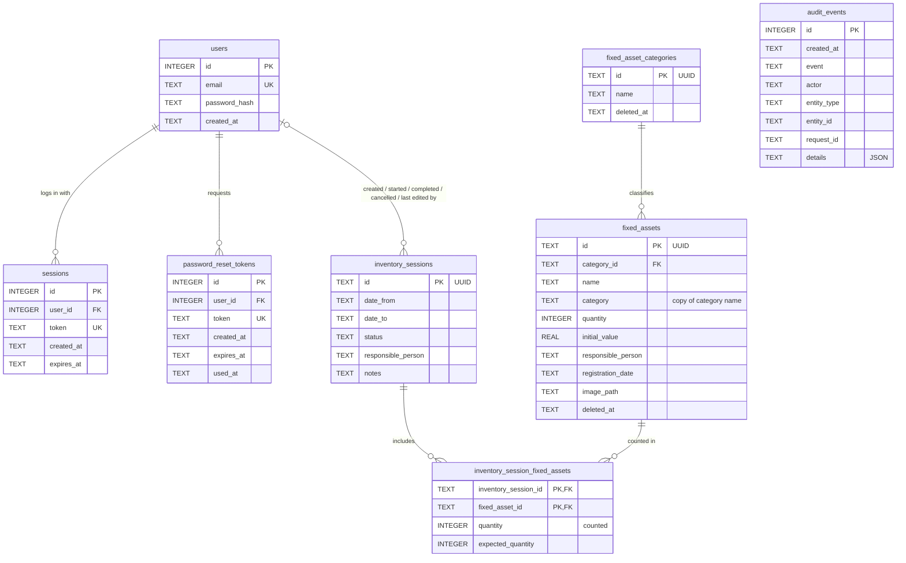

# Database

The app stores all its data in one SQLite file. Uploaded asset images are stored on disk in a separate folder. The database only holds their paths.

| | |
|---|---|
| File | `app.db` in the project folder, or the path in `DATABASE_PATH` |
| Images | `app/uploads/fixed-assets/`, or `UPLOADS_DIR/fixed-assets/` |
| Schema code | `app/db.py`, plus `app/repositories/audit_repository.py` for `audit_events` |
| Access | Raw `sqlite3` with parameterized SQL. No ORM |

To back up the app, copy both the database file and the uploads folder.

## Tables

`audit_events` has no foreign keys. It refers to records by `entity_type` and `entity_id`, so it keeps working after a record is deleted.

### `users`

Accounts that can log in.

| Column | Type | Notes |
|---|---|---|
| `id` | INTEGER PK | Auto-increment |
| `email` | TEXT | Required, unique |
| `password_hash` | TEXT | `pbkdf2_sha256$<iterations>$<salt hex>$<hash hex>`, 210,000 iterations |
| `created_at` | TEXT | Defaults to `CURRENT_TIMESTAMP` |

Admin rights are not stored here. They come from the `ADMIN_EMAILS` setting.

### `sessions`

Login sessions. The `token` is the value of the `session_token` cookie.

| Column | Type | Notes |
|---|---|---|
| `id` | INTEGER PK | Auto-increment |
| `user_id` | INTEGER | → `users.id`, `ON DELETE CASCADE` |
| `token` | TEXT | Unique, random (`secrets.token_urlsafe(32)`), indexed |
| `created_at` | TEXT | Defaults to `CURRENT_TIMESTAMP` |
| `expires_at` | TEXT | 24 hours after creation, ISO 8601 UTC |

Expired sessions are ignored when looked up. They are not deleted. Logout deletes the session row, and a password reset deletes all of that user's sessions.

### `password_reset_tokens`

One-time password reset links.

| Column | Type | Notes |
|---|---|---|
| `id` | INTEGER PK | Auto-increment |
| `user_id` | INTEGER | → `users.id`, `ON DELETE CASCADE` |
| `token` | TEXT | Unique, random, indexed |
| `created_at` | TEXT | Defaults to `CURRENT_TIMESTAMP` |
| `expires_at` | TEXT | 1 hour after creation |
| `used_at` | TEXT | Set when the token is used. A used token is no longer valid |

### `fixed_asset_categories`

| Column | Type | Notes |
|---|---|---|
| `id` | TEXT PK | UUID |
| `name` | TEXT | Required, max 100 characters |
| `deleted_at` | TEXT | Set on logical delete, otherwise `NULL` |

Category names are unique among categories that are not deleted, ignoring case. A partial unique index enforces this: `ux_fixed_asset_categories_active_name` on `lower(name) WHERE deleted_at IS NULL`. A deleted category's name can therefore be used again.

### `fixed_assets`

| Column | Type | Notes |
|---|---|---|
| `id` | TEXT PK | UUID |
| `category_id` | TEXT | → `fixed_asset_categories.id` |
| `name` | TEXT | Required, max 100 characters, indexed |
| `category` | TEXT | Copy of the category name, max 100 characters. See below |
| `quantity` | INTEGER | Default 1, must be ≥ 0 |
| `initial_value` | REAL | Required |
| `responsible_person` | TEXT | Required, max 100 characters |
| `registration_date` | TEXT | `YYYY-MM-DD` |
| `image_path` | TEXT | Relative to the uploads folder, e.g. `fixed-assets/<uuid>.jpg`. Optional |
| `deleted_at` | TEXT | Set on logical delete, otherwise `NULL`. Indexed |

The `category` column comes from an older version of the schema, where categories were free text. It is still filled on insert and update, and it is updated when a category is renamed. Queries read `COALESCE(fixed_asset_categories.name, fixed_assets.category)`, so the linked category's name wins.

### `inventory_sessions`

A stocktake over a date range, with the assets to be counted.

| Column | Type | Notes |
|---|---|---|
| `id` | TEXT PK | UUID |
| `date_from`, `date_to` | TEXT | `YYYY-MM-DD`. `date_from` is indexed |
| `status` | TEXT | `New`, `Active`, `Completed` or `Cancelled` (CHECK constraint). Indexed |
| `responsible_person` | TEXT | Required, max 100 characters |
| `notes` | TEXT | Optional |
| `completion_reason`, `cancellation_reason` | TEXT | Optional |
| `started_at`, `completed_at`, `cancelled_at` | TEXT | Set on the first move into that status |
| `created_at`, `updated_at`, `last_edited_at` | TEXT | ISO 8601 UTC |
| `created_by_user_id`, `started_by_user_id`, `completed_by_user_id`, `cancelled_by_user_id`, `last_edited_by_user_id` | INTEGER | → `users.id`, nullable |

How status changes affect the timestamps (`update_inventory_session` in `app/db.py`):

* Moving into `Active`, `Completed` or `Cancelled` sets that status's `*_at` and `*_by_user_id`, unless they are already set.
* Moving out of `Completed` or `Cancelled` (reopening) clears that status's `*_at` and `*_by_user_id`.
* `started_at` is never cleared.

Which transitions are allowed, and who may reopen a session, is decided in `app/services/inventory_sessions_service.py`.

Deleting an inventory session removes the row, and its asset links are removed with it.

### `inventory_session_fixed_assets`

Links assets to inventory sessions, with how many of each were expected and counted.

| Column | Type | Notes |
|---|---|---|
| `inventory_session_id` | TEXT | → `inventory_sessions.id`, `ON DELETE CASCADE` |
| `fixed_asset_id` | TEXT | → `fixed_assets.id`, `ON DELETE CASCADE` |
| `quantity` | INTEGER | Counted quantity. Default 1, must be ≥ 0. 0 means the asset was not found |
| `expected_quantity` | INTEGER | The asset's quantity when the session started, must be ≥ 0. `NULL` while the session is New |

The primary key is (`inventory_session_id`, `fixed_asset_id`), and both columns are indexed. When a session is saved, all its links are deleted and inserted again. Duplicate assets are merged by adding their quantities, and links with a negative quantity are dropped. A deleted asset cannot be newly linked, but an asset already linked to the session stays linked.

Expected quantities are saved so that a session's results don't change when an asset is edited later:

* While a session is New, `expected_quantity` is `NULL`, and pages show the asset's current quantity.
* When a session is saved in any other status, each link keeps the expected quantity it already has. A link without one gets the asset's current quantity. This happens when the session starts, and when an asset is added to an Active session.
* Reopening a session keeps its expected quantities. An asset that is removed and added again gets the current quantity.
* Queries read `COALESCE(expected_quantity, fixed_assets.quantity) AS expected_quantity`.

### `audit_events`

Who did what. Written through `audit()` in `app/logging_config.py`. See [Logging](../README.md#logging).

| Column | Type | Notes |
|---|---|---|
| `id` | INTEGER PK | Auto-increment. Newest events are listed first by `id` |
| `created_at` | TEXT | ISO 8601 UTC, seconds precision. Indexed |
| `event` | TEXT | E.g. `asset.deleted`, `auth.login_failed`. Indexed |
| `actor` | TEXT | Email of the user, if any. Indexed |
| `entity_type` | TEXT | `asset`, `category`, `inventory_session` or `user`, taken from the event prefix |
| `entity_id` | TEXT | ID of the affected record. Indexed together with `entity_type` |
| `request_id` | TEXT | Matches the `X-Request-ID` header and the request's log lines |
| `details` | TEXT | JSON object with the event's fields. Defaults to `{}` |

When `AUDIT_RETENTION_DAYS` is set, events older than that are deleted at startup.

## Logical deletion

Fixed assets and categories are never removed from the table. Deleting one sets `deleted_at` to the current UTC time. This keeps inventory sessions and their reports complete after an asset or category is deleted.

* Lists, counts, reports, filters and pickers only show rows where `deleted_at IS NULL`.
* `get_fixed_asset_by_id` also returns deleted assets, so inventory session pages can still show them. `get_fixed_asset_category_by_id` does not.
* A category cannot be deleted while assets that are not deleted still use it.
* A deleted asset cannot be edited, and a deleted category cannot be assigned to an asset.

Users and inventory sessions are deleted for real.

## Conventions

* **IDs.** Domain records (categories, assets, inventory sessions) use UUID strings. Auth tables and `audit_events` use integer auto-increment IDs.
* **Dates and times.** Stored as text. Dates are `YYYY-MM-DD`. Timestamps written by the app are ISO 8601 in UTC, e.g. `2026-11-20T09:15:00.123456+00:00`. Columns that default to `CURRENT_TIMESTAMP` use SQLite's format instead (`2026-11-20 09:15:00`, also UTC).
* **Foreign keys.** Turned on for every connection (`PRAGMA foreign_keys = ON`).
* **Transactions.** Every `app/db.py` function opens its own connection with `db_session()`, which commits on success, rolls back on error and closes the connection.
* **Rows.** Queries return `sqlite3.Row`, so columns can be read by name.

## Schema setup and migrations

There is no migration tool. On startup, `auth_service.initialize_defaults()` runs:

1. `initialize_database()` (`app/db.py`). Creates missing tables and indexes with `CREATE ... IF NOT EXISTS`, then brings older databases up to date:
   * adds missing columns with `ALTER TABLE ... ADD COLUMN` after checking `PRAGMA table_info`: `fixed_assets.category_id`, `quantity`, `image_path`, `deleted_at`; the audit and reason columns of `inventory_sessions`;
   * rebuilds `inventory_session_fixed_assets` to add `expected_quantity` and allow a quantity of 0 (`_migrate_inventory_session_fixed_assets_for_counts`). Links in sessions that were already started get the asset's quantity at the time of the migration as their expected quantity, because the quantity when they started was never stored;
   * fills empty `created_at`, `updated_at` and `last_edited_at` on inventory sessions;
   * rebuilds `fixed_asset_categories` without its old `UNIQUE(name)` constraint, which SQLite cannot drop in place (`_migrate_fixed_asset_categories_for_soft_delete`);
   * creates a category for each free-text `fixed_assets.category` value and sets `category_id` where it is missing.
2. `initialize_audit_storage()`. Creates `audit_events` and its indexes.
3. `ensure_default_user()`. Creates the demo or bootstrap admin account. See [Running in production](../README.md#running-in-production).

All steps can run any number of times. To change the schema, update the `CREATE TABLE` statement for new databases and add a matching step for existing ones, as above. `tests/unit/test_soft_delete.py` shows how to test a migration against a database in the old format.

## Working with the database

* **Test data.** `python -m scripts.seed_fixed_assets [count] [--seed N]` adds generated fixed assets (1000 by default).
* **Tests.** Set `DATABASE_PATH` to a temporary file (see `tests/unit/test_soft_delete.py`).
* **Inspecting.** `sqlite3 app.db` and then `.schema` shows the current schema.
* **Starting over.** Stop the app and delete `app.db`. It is created again on the next start.
