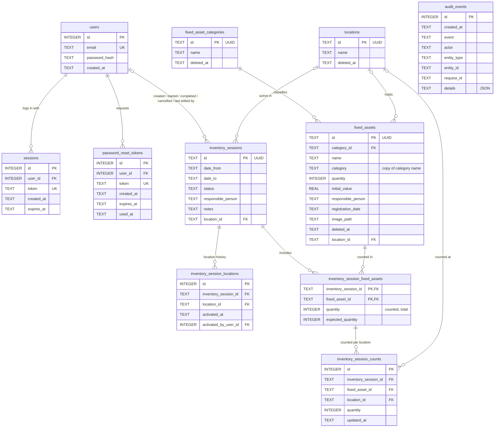

# Database

The app stores all its data in one SQLite file. Uploaded asset images are stored on disk in a separate folder. The database only holds their paths.

| | |
|---|---|
| File | `app.db` in the project folder, or the path in `DATABASE_PATH` |
| Images | `app/uploads/fixed-assets/`, or `UPLOADS_DIR/fixed-assets/` |
| Schema code | `app/db.py`, plus `app/repositories/audit_repository.py` for `audit_events` |
| Access | Raw `sqlite3` with parameterized SQL. No ORM |

To back up the app, copy both the database file and the uploads folder.

## Tables

`audit_events` has no foreign keys. It refers to records by `entity_type` and `entity_id`, so it keeps working after a record is deleted.

### `users`

Accounts that can log in.

| Column | Type | Notes |
|---|---|---|
| `id` | INTEGER PK | Auto-increment |
| `email` | TEXT | Required, unique |
| `password_hash` | TEXT | `pbkdf2_sha256$<iterations>$<salt hex>$<hash hex>`, 210,000 iterations |
| `created_at` | TEXT | Defaults to `CURRENT_TIMESTAMP` |
| `status` | TEXT | `pending` (registered, waiting for approval) or `active`. Default `active` |
| `is_admin` | INTEGER | 1 for administrators, otherwise 0 |
| `approved_at` | TEXT | When an administrator approved the account |
| `approved_by_user_id` | INTEGER | → `users.id`, `ON DELETE SET NULL` |

New registrations are `pending`, except for emails in `ADMIN_EMAIL` / `ADMIN_EMAILS`. Pending accounts can't log in: `get_session` only accepts sessions of active users, so no route can log one in by accident. Rejecting a request deletes the row. `is_admin` only counts for active accounts. `ensure_configured_admins()` runs at startup and makes the configured emails active administrators. Accounts that existed before approval was added stay active.

### `sessions`

Login sessions. The `token` is the value of the `session_token` cookie.

| Column | Type | Notes |
|---|---|---|
| `id` | INTEGER PK | Auto-increment |
| `user_id` | INTEGER | → `users.id`, `ON DELETE CASCADE` |
| `token` | TEXT | Unique, random (`secrets.token_urlsafe(32)`), indexed |
| `created_at` | TEXT | Defaults to `CURRENT_TIMESTAMP` |
| `expires_at` | TEXT | 24 hours after creation, ISO 8601 UTC |

Expired sessions are ignored when looked up. They are not deleted. Logout deletes the session row, and a password reset deletes all of that user's sessions.

### `password_reset_tokens`

One-time password reset links.

| Column | Type | Notes |
|---|---|---|
| `id` | INTEGER PK | Auto-increment |
| `user_id` | INTEGER | → `users.id`, `ON DELETE CASCADE` |
| `token` | TEXT | Unique, random, indexed |
| `created_at` | TEXT | Defaults to `CURRENT_TIMESTAMP` |
| `expires_at` | TEXT | 1 hour after creation |
| `used_at` | TEXT | Set when the token is used. A used token is no longer valid |

### `fixed_asset_categories`

| Column | Type | Notes |
|---|---|---|
| `id` | TEXT PK | UUID |
| `name` | TEXT | Required, max 100 characters |
| `deleted_at` | TEXT | Set on logical delete, otherwise `NULL` |

Category names are unique among categories that are not deleted, ignoring case. A partial unique index enforces this: `ux_fixed_asset_categories_active_name` on `lower(name) WHERE deleted_at IS NULL`. A deleted category's name can therefore be used again.

### `fixed_assets`

| Column | Type | Notes |
|---|---|---|
| `id` | TEXT PK | UUID |
| `category_id` | TEXT | → `fixed_asset_categories.id` |
| `name` | TEXT | Required, max 100 characters, indexed |
| `category` | TEXT | Copy of the category name, max 100 characters. See below |
| `quantity` | INTEGER | Default 1, must be ≥ 0 |
| `initial_value` | REAL | Required |
| `responsible_person` | TEXT | Required, max 100 characters |
| `registration_date` | TEXT | `YYYY-MM-DD` |
| `image_path` | TEXT | Relative to the uploads folder, e.g. `fixed-assets/<uuid>.jpg`. Optional |
| `deleted_at` | TEXT | Set on logical delete, otherwise `NULL`. Indexed |
| `location_id` | TEXT | → `locations.id`. Optional. Indexed |

`import_fixed_assets` adds many assets in one transaction, all or none. It matches categories and locations by name, ignoring case, and creates the missing ones. The CSV file is read and every row is checked first (`app/services/asset_import_service.py`). Between the preview and the confirmation, the upload waits in the system temp folder (`asset-registry-imports`), not in the public uploads folder, and is deleted after an hour.

The `category` column comes from an older version of the schema, where categories were free text. It is still filled on insert and update, and it is updated when a category is renamed. Queries read `COALESCE(fixed_asset_categories.name, fixed_assets.category)`, so the linked category's name wins.

### `locations`

Where assets are kept, such as a room, building or site. Managed on the Locations page (`/locations`).

| Column | Type | Notes |
|---|---|---|
| `id` | TEXT PK | UUID |
| `name` | TEXT | Required, max 100 characters |
| `deleted_at` | TEXT | Set on logical delete, otherwise `NULL` |

Like categories, names are unique among locations that are not deleted, ignoring case (`ux_locations_active_name` on `lower(name) WHERE deleted_at IS NULL`). Unlike categories, a location is optional on an asset.

The fixed assets list can be filtered by location names. The filter value `(none)` (`NO_LOCATION_FILTER` in `app/db.py`) matches assets without a location.

### `inventory_sessions`

A stocktake over a date range, with the assets to be counted.

| Column | Type | Notes |
|---|---|---|
| `id` | TEXT PK | UUID |
| `date_from`, `date_to` | TEXT | `YYYY-MM-DD`. `date_from` is indexed |
| `status` | TEXT | `New`, `Active`, `Completed` or `Cancelled` (CHECK constraint). Indexed |
| `responsible_person` | TEXT | Required, max 100 characters |
| `notes` | TEXT | Optional |
| `completion_reason`, `cancellation_reason` | TEXT | Optional |
| `started_at`, `completed_at`, `cancelled_at` | TEXT | Set on the first move into that status |
| `created_at`, `updated_at`, `last_edited_at` | TEXT | ISO 8601 UTC |
| `created_by_user_id`, `started_by_user_id`, `completed_by_user_id`, `cancelled_by_user_id`, `last_edited_by_user_id` | INTEGER | → `users.id`, nullable |
| `location_id` | TEXT | → `locations.id`. The **active location**: where counts are recorded now. `NULL`: counting with no location |

The active location can change any number of times while a session is New or Active (`set_active_location`, from the edit page and the counting page). Every change, and the starting location chosen when the session is created, is added to `inventory_session_locations`. Changing it sets `updated_at`, so an edit page opened before refuses to save its counts at the new location. Any asset in the register can be added to a session, wherever it is registered; "Add all assets registered at …" on the edit page is a shortcut for the active location. `update_inventory_session` keeps the active location unless `location_id` is passed, and then records the change in the history too.

How status changes affect the timestamps (`update_inventory_session` in `app/db.py`):

* Moving into `Active`, `Completed` or `Cancelled` sets that status's `*_at` and `*_by_user_id`, unless they are already set.
* Moving out of `Completed` or `Cancelled` (reopening) clears that status's `*_at` and `*_by_user_id`.
* `started_at` is never cleared.

Which transitions are allowed, and who may reopen a session, is decided in `app/services/inventory_sessions_service.py`.

Deleting an inventory session removes the row, and its asset links are removed with it.

### `inventory_session_fixed_assets`

Links assets to inventory sessions, with how many of each were expected and counted.

| Column | Type | Notes |
|---|---|---|
| `inventory_session_id` | TEXT | → `inventory_sessions.id`, `ON DELETE CASCADE` |
| `fixed_asset_id` | TEXT | → `fixed_assets.id`, `ON DELETE CASCADE` |
| `quantity` | INTEGER | Total counted over all locations: the sum of the asset's rows in `inventory_session_counts`, kept up to date by every write in the same transaction. Must be ≥ 0. 0 means the asset was not found |
| `expected_quantity` | INTEGER | The asset's quantity when the session started, must be ≥ 0. `NULL` while the session is New |

The primary key is (`inventory_session_id`, `fixed_asset_id`), and both columns are indexed. Saving the edit page updates the links in place: assets left out are removed (with their counts), new ones are added, and each submitted quantity is the count at the active location. Duplicate assets are merged by adding their quantities, and links with a negative quantity are dropped. A deleted asset cannot be newly linked, but an asset already linked to the session stays linked. Start, Complete and Cancel don't touch the links or counts.

Expected quantities are saved so that a session's results don't change when an asset is edited later:

* While a session is New, `expected_quantity` is `NULL`, and pages show the asset's current quantity.
* When a session is saved in any other status, each link keeps the expected quantity it already has. A link without one gets the asset's current quantity. This happens when the session starts, and when an asset is added to an Active session.
* Reopening a session keeps its expected quantities. An asset that is removed and added again gets the current quantity.
* Queries read `COALESCE(expected_quantity, fixed_assets.quantity) AS expected_quantity`.

Counting by scanning labels (`adjust_inventory_count`) changes one count at a time, only in Active sessions:

* It changes the asset's count at the active location and then the total. The first write is an UPDATE, which takes SQLite's write lock before a missing row is inserted, so two phones counting the same asset don't lose a count. Counts never go below 0, and a minus where nothing is counted at the active location changes nothing.
* Scanning an asset that is not in the session adds it, with its current quantity as expected, wherever it is registered. When the active location differs from the asset's location in the register, the result says so.
* It sets the session's `updated_at`. The edit page sends the `updated_at` it was loaded with, and a save is refused if the session changed since, because it would overwrite the counts.

### `inventory_session_counts`

What was counted of an asset at one location in a session.

| Column | Type | Notes |
|---|---|---|
| `id` | INTEGER PK | Auto-increment |
| `inventory_session_id`, `fixed_asset_id` | TEXT | → the link in `inventory_session_fixed_assets`, `ON DELETE CASCADE` (removing an asset from a session removes its counts) |
| `location_id` | TEXT | → `locations.id`. `NULL`: counted with no active location |
| `quantity` | INTEGER | Must be ≥ 0 |
| `updated_at` | TEXT | Last change |

One row per asset and location: `ux_inventory_session_counts_location` covers rows with a location and `ux_inventory_session_counts_no_location` the ones without, because SQLite treats NULLs as distinct in a unique index. A count of 0 is only stored when an existing count is set to 0; a missing row means nothing was counted there. The session page and the PDF report list the counts as "Counted at", for example `Room A: 3 · Room B: 2`, next to the asset's location in the register.

### `inventory_session_locations`

The history of a session's active location, oldest first.

| Column | Type | Notes |
|---|---|---|
| `id` | INTEGER PK | Auto-increment |
| `inventory_session_id` | TEXT | → `inventory_sessions.id`, `ON DELETE CASCADE` |
| `location_id` | TEXT | → `locations.id`. `NULL`: counting with no location from then on |
| `activated_at` | TEXT | When it became active |
| `activated_by_user_id` | INTEGER | → `users.id`, `ON DELETE SET NULL` |

### `audit_events`

Who did what. Written through `audit()` in `app/logging_config.py`. See [Logging](../README.md#logging).

| Column | Type | Notes |
|---|---|---|
| `id` | INTEGER PK | Auto-increment. Newest events are listed first by `id` |
| `created_at` | TEXT | ISO 8601 UTC, seconds precision. Indexed |
| `event` | TEXT | E.g. `asset.deleted`, `auth.login_failed`. Indexed |
| `actor` | TEXT | Email of the user, if any. Indexed |
| `entity_type` | TEXT | `asset`, `category`, `location`, `inventory_session` or `user`, taken from the event prefix |
| `entity_id` | TEXT | ID of the affected record. Indexed together with `entity_type` |
| `request_id` | TEXT | Matches the `X-Request-ID` header and the request's log lines |
| `details` | TEXT | JSON object with the event's fields. Defaults to `{}` |

When `AUDIT_RETENTION_DAYS` is set, events older than that are deleted at startup.

## Logical deletion

Fixed assets, categories and locations are never removed from the table. Deleting one sets `deleted_at` to the current UTC time. This keeps inventory sessions and their reports complete after an asset, category or location is deleted.

* Lists, counts, reports, filters and pickers only show rows where `deleted_at IS NULL`.
* `get_fixed_asset_by_id` also returns deleted assets, so inventory session pages can still show them. `get_fixed_asset_category_by_id` does not.
* A category or location cannot be deleted while assets that are not deleted still use it.
* A deleted asset cannot be edited, and a deleted category or location cannot be assigned to an asset or a new session. A session keeps a location that is deleted later.

Users and inventory sessions are deleted for real.

## Conventions

* **IDs.** Domain records (categories, locations, assets, inventory sessions) use UUID strings. Auth tables and `audit_events` use integer auto-increment IDs.
* **Dates and times.** Stored as text. Dates are `YYYY-MM-DD`. Timestamps written by the app are ISO 8601 in UTC, e.g. `2026-11-20T09:15:00.123456+00:00`. Columns that default to `CURRENT_TIMESTAMP` use SQLite's format instead (`2026-11-20 09:15:00`, also UTC).
* **Foreign keys.** Turned on for every connection (`PRAGMA foreign_keys = ON`).
* **Transactions.** Every `app/db.py` function opens its own connection with `db_session()`, which commits on success, rolls back on error and closes the connection.
* **Rows.** Queries return `sqlite3.Row`, so columns can be read by name.

## Schema setup and migrations

There is no migration tool. On startup, `auth_service.initialize_defaults()` runs:

1. `initialize_database()` (`app/db.py`). Creates missing tables and indexes with `CREATE ... IF NOT EXISTS`, then brings older databases up to date:
   * adds missing columns with `ALTER TABLE ... ADD COLUMN` after checking `PRAGMA table_info`: the approval and admin columns of `users`; `fixed_assets.category_id`, `quantity`, `image_path`, `deleted_at`, `location_id`; the audit, reason and `location_id` columns of `inventory_sessions`;
   * creates `inventory_session_counts` and `inventory_session_locations` (`_create_session_location_tables`), after the links table's own migration below. On first creation each counted link gets one count at its session's location, and each session with a location gets it as the first history entry (dated when the session started);
   * rebuilds `inventory_session_fixed_assets` to add `expected_quantity` and allow a quantity of 0 (`_migrate_inventory_session_fixed_assets_for_counts`). Links in sessions that were already started get the asset's quantity at the time of the migration as their expected quantity, because the quantity when they started was never stored;
   * fills empty `created_at`, `updated_at` and `last_edited_at` on inventory sessions;
   * rebuilds `fixed_asset_categories` without its old `UNIQUE(name)` constraint, which SQLite cannot drop in place (`_migrate_fixed_asset_categories_for_soft_delete`);
   * creates a category for each free-text `fixed_assets.category` value and sets `category_id` where it is missing.
2. `initialize_audit_storage()`. Creates `audit_events` and its indexes.
3. `ensure_default_user()`. Creates the demo or bootstrap admin account. See [Running in production](../README.md#running-in-production).
4. `ensure_configured_admins()`. Makes the accounts in `ADMIN_EMAIL` / `ADMIN_EMAILS` active administrators.

All steps can run any number of times. To change the schema, update the `CREATE TABLE` statement for new databases and add a matching step for existing ones, as above. `tests/unit/test_soft_delete.py` and `tests/unit/test_locations.py` show how to test a migration against a database in the old format.

## Working with the database

* **Test data.** `python -m scripts.seed_fixed_assets [count] [--seed N]` adds generated fixed assets (1000 by default).
* **Tests.** Set `DATABASE_PATH` to a temporary file (see `tests/unit/test_soft_delete.py`).
* **Inspecting.** `sqlite3 app.db` and then `.schema` shows the current schema.
* **Starting over.** Stop the app and delete `app.db`. It is created again on the next start.
